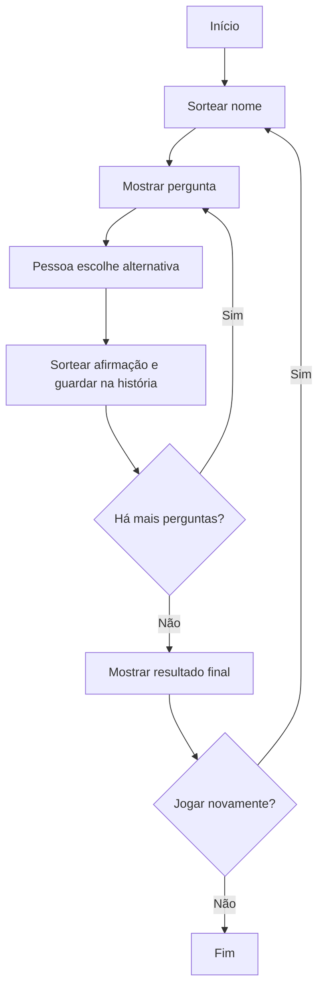

# Você decide o futuro da IA

Projeto educacional da unidade Start by Alura.

## Como executar

1. Baixe os arquivos do repositório.
2. Para testar módulos JavaScript (`import`/`export`), abra o projeto usando um servidor local (por exemplo, a extensão Live Server do Visual Studio Code). Alguns navegadores bloqueiam módulos quando o HTML é aberto diretamente pelo caminho `file://`.
3. Abra `index.html` pelo servidor local.

## Requisitos demonstrados

- **Aleatoriedade:** `sortearItem()` utiliza `Math.random()` e `Math.floor()`.
- **Módulos:** `utils.js` exporta `nomes` e `sortearItem`; `script.js` importa os dois.
- **Condicionais:** `if` verifica quando o jogo terminou.
- **Fluxo de execução:** o fluxograma abaixo representa o ciclo do jogo.
- **`for...of` e parada:** `jogoTerminou()` percorre as perguntas e usa `break` quando encontra a pergunta atual.
- **`replace()`:** substitui “você” pelo nome sorteado nas perguntas e “NOME” na introdução do resultado.

## Fluxograma

